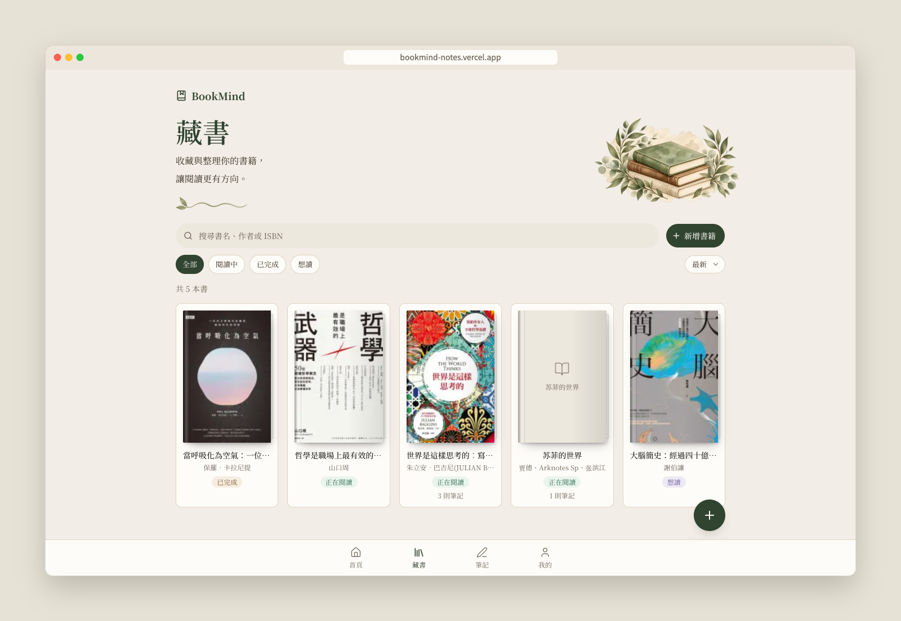
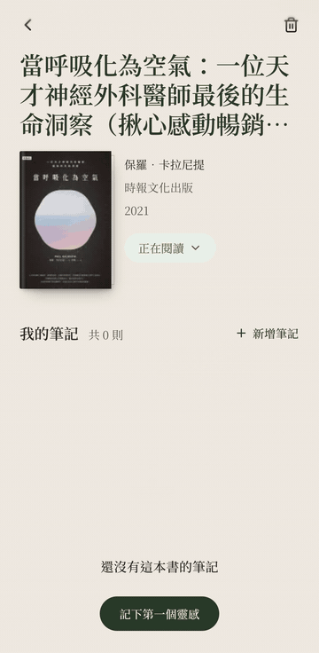
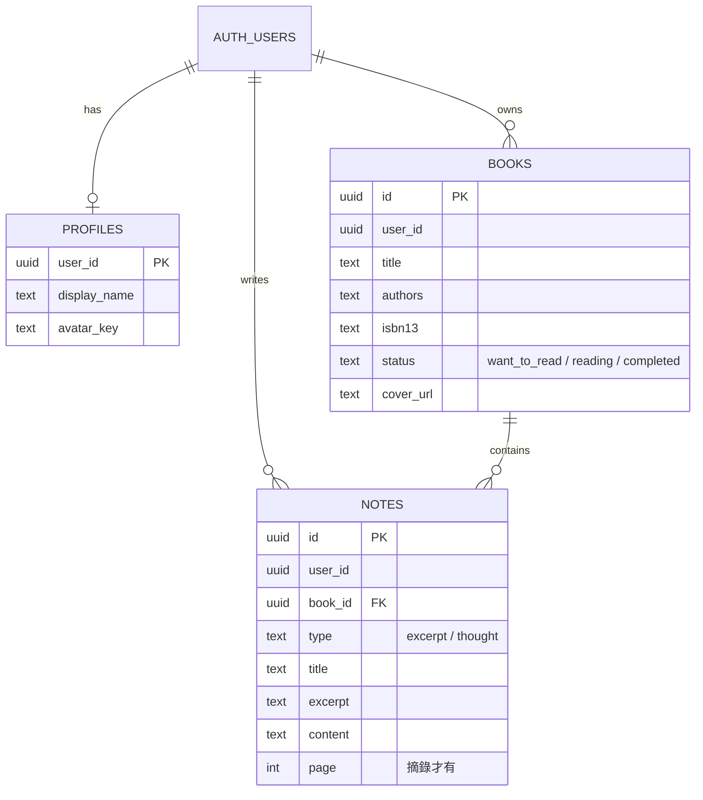

<div align="center">
  <picture>
    <source media="(prefers-color-scheme: dark)" srcset="docs/images/logo-dark.png">
    
  </picture>

#### 將字裡行間的靈感記錄下來 —— 
#### 一個管理藏書與閱讀筆記的 PWA。
免註冊，點開就能用！

**[👀 線上體驗：bookmind-notes.vercel.app](https://bookmind-notes.vercel.app)**　

</div>

### 📜 目錄

<details>
<summary>展開目錄</summary>

- [💡 專案簡介](#-專案簡介)
- [📸 畫面預覽](#-畫面預覽)
- [🧩 技術棧](#-技術棧)
- [✨ 主要功能](#-主要功能)
  - [其他功能](#其他功能)
  - [未來規劃](#-未來規劃)
- [🧠 技術重點](#-技術重點)
- [🚀 本地執行](#-本地執行)
- [📑 開發過程](#-開發過程)
  - [資料表關聯圖](#資料表關聯圖)
  - [資料夾結構](#-資料夾結構)
- [🔒 授權](#-授權)

</details>

## 💡 專案簡介

BookMind 是一個以手機為主要使用情境的閱讀筆記 App。搜尋或掃描 ISBN 就能把書加進書櫃，讀到喜歡的句子隨手記成「摘錄」，有想法就寫成「心得」，每則筆記都會歸在它出自的那本書底下。

不需要註冊，打開網頁就能開始記錄；之後連結 Google 帳號，資料會原封不動地保留下來，換裝置也看得到。也可以把網頁加到手機主畫面，用起來就像一般 App。

## 📸 畫面預覽

部署於 [Vercel](https://vercel.com/)，資料庫與登入使用 [Supabase](https://supabase.com/)。




## 🧩 技術棧

#### 前端

- [Next.js 16](https://nextjs.org/)（App Router）- Server Components 讀資料、Server Actions 寫資料
- [React 19](https://react.dev/) - 建構互動元件
- [TypeScript](https://www.typescriptlang.org/)（strict mode）- 靜態型別檢查
- [Tailwind CSS 4](https://tailwindcss.com/) - 以設計 token 統一管理樣式
- [shadcn/ui](https://ui.shadcn.com/)（Base UI）- 可自訂的無障礙元件
- [React Hook Form](https://react-hook-form.com/) + [Zod 4](https://zod.dev/) - 表單狀態與驗證
- [barcode-detector](https://github.com/Sec-ant/barcode-detector) - ISBN 條碼掃描（ZXing WebAssembly）
- [@ducanh2912/next-pwa](https://github.com/DuCanhGH/next-pwa) - PWA 與離線快取

#### 後端與資料

- [Supabase](https://supabase.com/) - PostgreSQL 資料庫、匿名登入、Google OAuth、Row Level Security
- [Google Books API](https://developers.google.com/books) - 書籍搜尋（透過 API Route 呼叫，不暴露金鑰）
- [Vercel](https://vercel.com/) - 部署，並以 Vercel Cron 每日喚醒免費版資料庫

## ✨ 主要功能

<table>
  <tr>
    <td width="55%">
      <h3>加入一本書</h3>
      搜尋書名或掃描 ISBN，從結果中挑出要的書，在預覽框選好閱讀狀態後加入書櫃。
    </td>
    <td align="center">
      
    </td>
  </tr>
  <tr>
    <td>
      <h3>記一則摘錄</h3>
      從書籍詳情頁新增筆記。選「摘錄」可以附上頁碼和標題，儲存後回到書籍頁，新筆記會排在最上面。
    </td>
    <td align="center">
      
    </td>
  </tr>
  <tr>
    <td>
      <h3>切換狀態、管理筆記</h3>
      用下拉選單切換閱讀狀態。筆記卡往左滑會出現編輯和刪除，刪除前會再確認一次。
    </td>
    <td align="center">
      
    </td>
  </tr>
  <tr>
    <td>
      <h3>搜尋、篩選、排序</h3>
      依閱讀狀態篩選、切換排序、輸入關鍵字搜尋。條件都記在網址上，重新整理或分享連結都不會消失。
    </td>
    <td align="center">
      
    </td>
  </tr>
</table>

### 其他功能

**書籍管理**

- 以書名、作者關鍵字搜尋，或掃描 ISBN 條碼加入書籍
- 依「想讀／閱讀中／已讀完」分類，支援搜尋、篩選與排序
- 書籍詳情頁可切換閱讀狀態、查看這本書的所有筆記

**筆記**

- 兩種筆記類型：摘錄（書中原句，可附頁碼）與心得
- 筆記頁集中瀏覽所有筆記，可依類型篩選與搜尋
- 筆記詳情、編輯、刪除，刪除前一律二次確認

**帳號與資料**

- 免註冊即可使用，之後可連結 Google 帳號，原有資料完整保留
- 自訂暱稱與預設頭像
- 將所有筆記匯出為 Markdown 檔
- 清除本機資料、登出

**其他**

- 首頁儀表板：閱讀統計、正在閱讀、最近筆記
- PWA：可加到手機主畫面，以 App 模式開啟
- Mobile First 響應式設計，手機、平板、桌機皆可使用

### 🤔 未來規劃

- 掃描結果加入「不是這本？」選項，列出其他候選書籍
- 手動編輯書籍資料（作者、頁數、封面）
- 加入更多書籍資料來源，補足 Google Books 缺漏的中文書資訊

## 🧠 技術重點

<details>
<summary>展開說明</summary>

- **免註冊也能存資料**：`src/proxy.ts` 偵測到沒有使用者時，自動以 Supabase 匿名登入建立帳號；之後用 `linkIdentity` 把 Google 帳號綁到同一個使用者上，原本的書與筆記不需要搬移。
- **資料隔離靠資料庫，不靠前端**：每張表都開啟 Row Level Security，policy 限定 `auth.uid() = user_id`，就算前端程式有漏洞，也讀不到別人的資料。
- **讀寫分離**：讀取集中在 `src/lib/queries/`（`server-only`，只在伺服器執行），寫入統一走 Server Actions，經 Zod 驗證後再 `revalidatePath` 更新畫面。
- **篩選狀態放在網址**：搜尋、篩選、排序都存在 URL searchParams，頁面本身維持 Server Component，重新整理或分享連結都會保留狀態。
- **API 金鑰不進瀏覽器**：Google Books 由 API Route 代為呼叫，並對暫時性錯誤自動重試。
- **免費方案的維運**：Supabase 免費版閒置一週會暫停，以 Vercel Cron 每日呼叫受 `CRON_SECRET` 保護的 `/api/keep-alive`。

</details>

## 🚀 本地執行

1. 下載專案並安裝套件（需要 Node.js 20 以上）

```bash
git clone https://github.com/KatherineHYC/bookmind.git
cd bookmind
npm install
```

2. 建立 Supabase 專案，在 SQL Editor 依序執行 `supabase/migrations/` 裡的 SQL 檔（0001 → 0009），並在 Authentication 設定中開啟 Anonymous Sign-ins

3. 複製環境變數範本，填入自己的值（每個變數的用途寫在檔案註解裡）

```bash
cp .env.example .env.local
```

4. 啟動開發伺服器，開啟 `http://localhost:3000`

```bash
npm run dev
```

> 開發模式下 PWA 是關閉的。要測試 PWA，請用 `npm run build && npm run start`。

## 🤯 開發過程

#### 資料表關聯圖



#### 📦 資料夾結構

<details>
<summary>展開結構</summary>

```
src
├── app
│   ├── (main)          # 有底部導覽列的主要頁面：首頁、藏書、筆記、我的
│   ├── (focus)         # 專注型頁面：新增書籍、書籍詳情、新增／編輯筆記
│   ├── actions         # Server Actions（寫入）
│   ├── api             # 書籍搜尋、keep-alive
│   └── auth/callback   # OAuth 回呼
├── components
│   ├── ui              # shadcn/ui 產生的元件
│   ├── layouts         # 頁面外殼
│   ├── features        # 跨頁面共用元件
│   └── books / notes / home / settings / landing   # 各領域元件
├── lib
│   ├── queries         # 集中的查詢層（讀取）
│   └── supabase        # Server / Client 的 Supabase client
├── types               # 手動維護的型別
└── proxy.ts            # 刷新 session、自動匿名登入
```

</details>

## 🔒 授權

本專案採用 [MIT License](LICENSE)。
